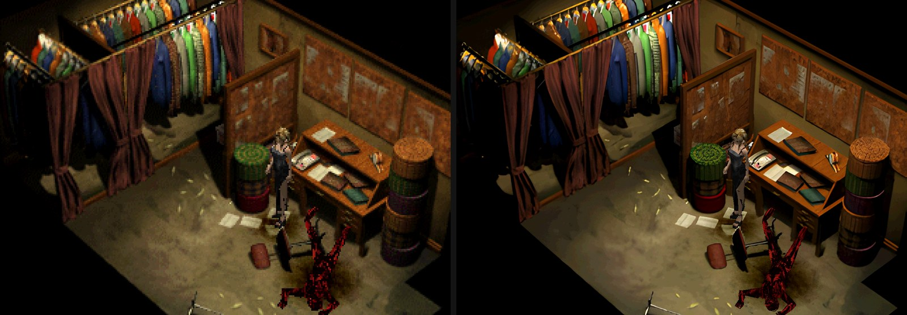
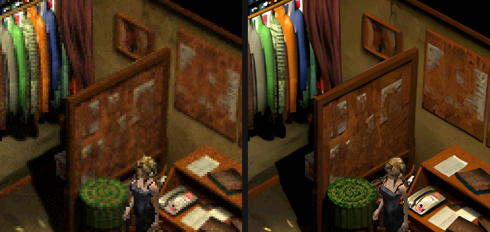

# Parasite Eve for Mac

A native macOS version of **Parasite Eve** (PlayStation, 1998) for Apple
Silicon Macs. It is not an emulator: the game's own code runs natively on
your Mac, with the PlayStation hardware (graphics, sound, CD drive, memory
cards and controller) recreated for macOS.


*Left: the original 320×240 picture. Right: this version at 4× internal
resolution with HD backgrounds.*

> **You need your own copy of the game.** This download contains no game
> data. You install it from your own disc images of the North American
> release (SLUS-00662 / SLUS-00668).

## Download

Get **ParasiteEve.dmg** from the [latest release](../../releases/latest).

Requirements: a Mac with Apple Silicon (M1 or later), macOS 14 Sonoma or
newer.

## Install

1. Open `ParasiteEve.dmg` and drag **Parasite Eve** into **Applications**.
2. Open the app. Because it isn't notarized by Apple, the first time you
   have to right-click the app → **Open** (or go to *System Settings →
   Privacy & Security → Open Anyway*).
3. Drop your disc images onto the window: **Disc 1** is required, and
   **Disc 2** can be added now or later. A `.cue` file with its `.bin`, a
   single `.bin`, or an `.iso` all work. You can also click a disc row to
   choose the file.
4. Press **Play**.

Each disc is installed once, which takes a few seconds, and after that you
no longer need the disc images. Both discs are installed side by side, so
the game never asks you to swap discs. Right-click a disc row to replace or
remove it.

Use the `.cue`/`.bin` dumps if you can: an `.iso` has no room for the movie
soundtrack, so cutscenes play silently.

## Controls

| Key | PlayStation button |
| --- | --- |
| W A S D (or arrow keys) | D-pad |
| Enter / X | ✕ (confirm) |
| Delete / Z | ○ (cancel) |
| Escape / Q | △ |
| E | □ |
| Space | Start |
| Tab | Select |
| F (hold) | Fast-forward the current scene and skip dialogue |

Game controllers are not supported yet.

## Settings

Press **F1** (or **⌘,**) in the game for the settings menu: output
resolution up to 4K, internal rendering resolution up to 10×, aspect ratio,
sharp or smooth filtering, HD backgrounds, and fullscreen (**⌃⌘F**).

At a higher internal resolution the 3D characters are drawn smoothly: no
PlayStation vertex wobble, no texture warping, and no flickering seams
between body parts.

## HD backgrounds

The pre-rendered room backgrounds can be shown in HD, upscaled 4× by an AI
upscaler ([Real-ESRGAN](https://github.com/xinntao/Real-ESRGAN), included
in the app). The approach is the same as the
[Parasite Eve HD Remaster](https://github.com/faligame/Parasite-Eve-HD-Remaster)
project: each camera view is rebuilt as one picture, upscaled as a whole,
and drawn back exactly where the original tiles were.



It is on by default and needs nothing from you. The first time you enter a
room, the game upscales its background in the background (a few seconds,
on the GPU) and switches to HD as soon as it is done; after that the room
is HD right away. It takes effect at an internal resolution of 2× or more
and can be turned off in the F1 menu. The HD images are made from your own
copy of the game and stay on your Mac
(`~/Library/Application Support/ParasiteEveMac/hd`).

## Saves

Save at the in-game save points and load with **Continue** on the title
screen, just like on the console. The two memory cards are stored as
standard `.mcd` card images in

```
~/Library/Application Support/ParasiteEveMac/memcards/
```

These are the same format DuckStation, ePSXe and Mednafen use, so you can
copy saves between them and this version.

## Where things are

| What | Location |
| --- | --- |
| Installed disc files | `~/Library/Application Support/ParasiteEveMac/disc/` |
| Memory cards | `~/Library/Application Support/ParasiteEveMac/memcards/` |
| Settings | `~/Library/Application Support/ParasiteEveMac/settings.ini` |
| HD backgrounds | `~/Library/Application Support/ParasiteEveMac/hd/` |
| Game log | `~/Library/Logs/ParasiteEveMac/pe1mac.log` (previous run: `pe1mac.prev.log`) |

To uninstall, delete the app and the `ParasiteEveMac` folder in
`~/Library/Application Support`.

## Status

This is a work in progress. The opening and early game are playable from
start to save point, including cutscenes, battles, music and saving. Later
parts of the story have not been played through yet, so expect bugs there.

If the game crashes, the launcher reopens and points you to the log. Please
include `pe1mac.log` when you report a problem.

## Legal

Parasite Eve © Square Enix. This is an unofficial fan project, not
affiliated with or endorsed by Square Enix. No game data is included or
distributed; you must own the game. Screenshots are shown for comparison
only.

The app includes Real-ESRGAN (BSD 3-Clause) and realesrgan-ncnn-vulkan
(MIT) by Xintao Wang; their licenses are in the app bundle.
